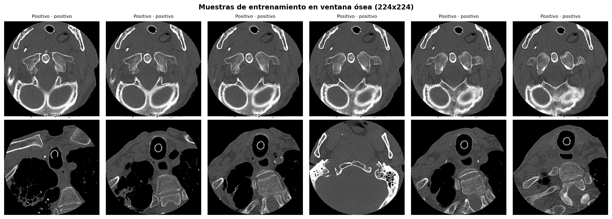
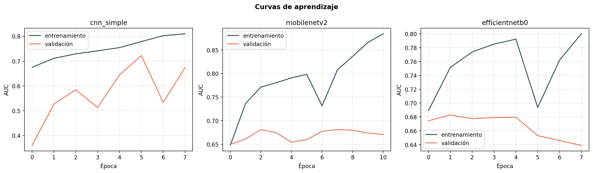
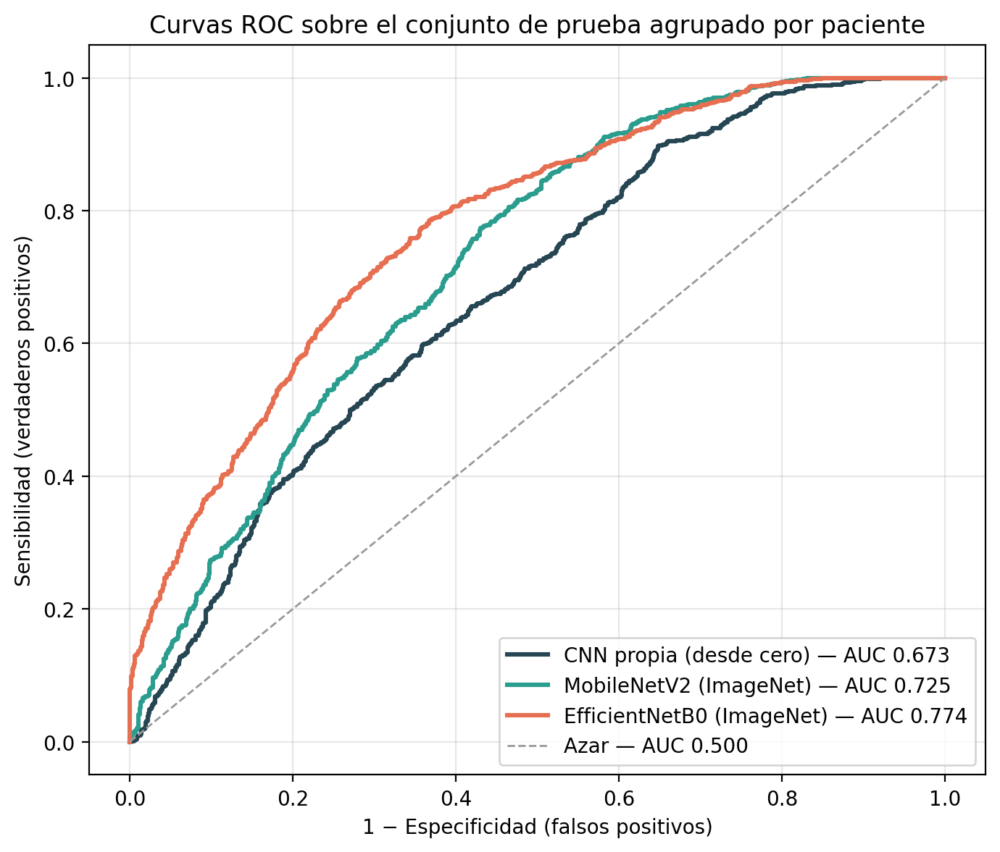
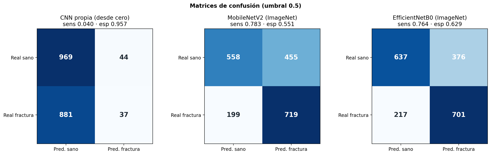
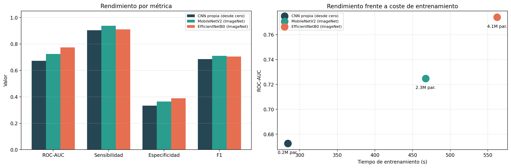
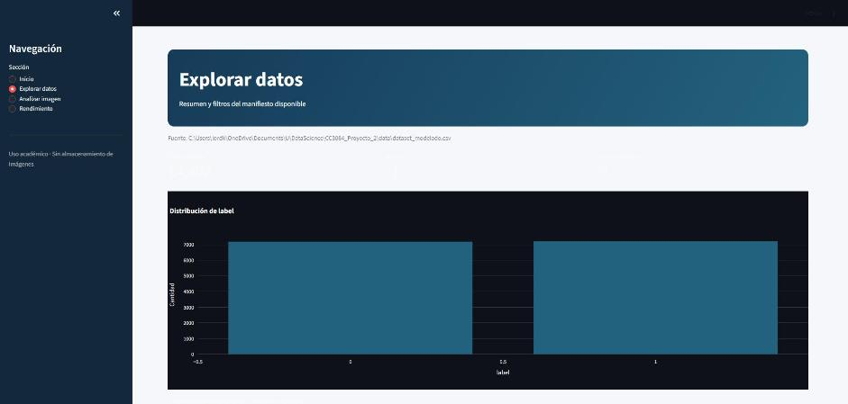
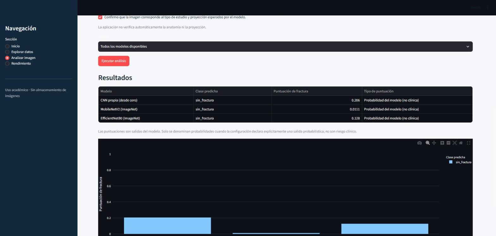
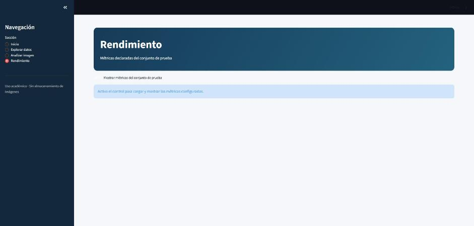
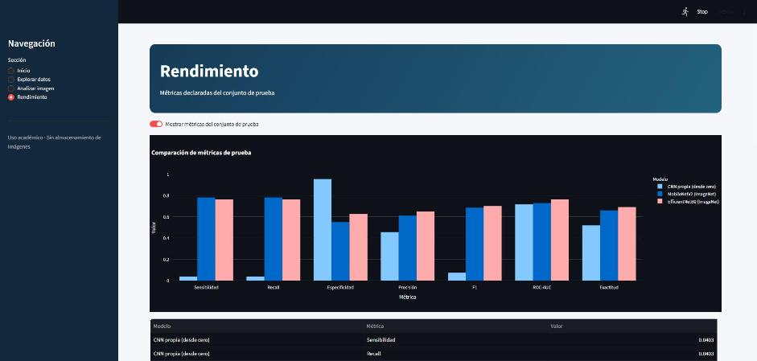

# Detección automática de fracturas cervicales en tomografía computarizada
## Construcción, evaluación y comparación de modelos de aprendizaje profundo

**Proyecto 2 — Fase de resultados · Reto 20**
CC3084 · Data Science · Universidad del Valle de Guatemala · Semestre II 2026

| | |
|---|---|
| Conjunto de datos | [RSNA 2022 Cervical Spine Fracture Detection](https://www.kaggle.com/competitions/rsna-2022-cervical-spine-fracture-detection) |
| Repositorio | https://github.com/rodrigoajmac/CC3084_Proyecto_2 |
| Aplicación | Streamlit — carpeta `Aplicacion/` |

---

## 1. Introducción

### 1.1 Contenido del informe

Este informe documenta la segunda fase del Proyecto 2. La primera fase produjo un
análisis exploratorio del conjunto RSNA 2022 Cervical Spine Fracture Detection; esta
segunda fase parte de aquellos hallazgos para **construir, ajustar, evaluar y comparar
modelos de aprendizaje automático**, y para exponerlos en una aplicación interactiva que
permite clasificar imágenes nuevas.

El documento se organiza así: la sección 2 fija los objetivos; la sección 3 reúne el
marco teórico de procesamiento de imagen médica y de los algoritmos empleados; la
sección 4 describe la metodología, incluyendo la partición de datos y la justificación
de cada elección; la sección 5 presenta los resultados, su análisis comparativo y la
aplicación construida; la sección 6 cierra con las conclusiones.

### 1.2 Problema a resolver

La fractura de la columna cervical es una lesión de baja prevalencia y alta consecuencia.
Más de un millón de pacientes son evaluados cada año en Estados Unidos por sospecha de
lesión cervical, y en adultos la tomografía computarizada ha desplazado casi por completo
a la radiografía simple como estudio de elección (Minja et al., 2018). Entre el 10 % y el
11 % de las fracturas cervicales derivan en lesión de la médula espinal (Fredø et al.,
2014), de modo que un diagnóstico tardío puede traducirse en deterioro neurológico
irreversible.

La dificultad no es solo clínica sino computacional. El análisis exploratorio de la fase
anterior estableció tres hechos que condicionan cualquier solución:

1. **La lesión es diminuta en relación con la imagen.** La región delimitada por las
   anotaciones ocupa una mediana del 2.415 % de un corte de 512 × 512 píxeles, una
   relación fondo-a-lesión cercana a 41 : 1.
2. **La supervisión espacial es escasa.** Solo el 11.64 % de los estudios tiene
   *bounding box* y el 4.31 % tiene segmentación vertebral; tres de cada cuatro casos
   positivos carecen de localización.
3. **Existe un riesgo real de atajo.** Las variables de adquisición difieren de forma
   estadísticamente significativa entre clases (`n_slices`, p = 1.82 × 10⁻⁸), de modo que
   un modelo puede aprender a reconocer el protocolo del hospital en lugar de la lesión.

El problema que resuelve esta fase se enuncia así:

> **¿Es posible entrenar un clasificador que, a partir de un corte axial de tomografía
> cervical, identifique la presencia de una fractura visible con una sensibilidad y
> especificidad útiles, sin que su desempeño se explique por atajos de adquisición ni por
> fuga de información entre pacientes?**

---

## 2. Objetivos

### 2.1 Objetivo general

Construir, ajustar y comparar modelos de aprendizaje profundo capaces de clasificar la
presencia de fractura cervical visible en cortes axiales de tomografía computarizada, y
exponerlos en una aplicación interactiva que permita explorar los datos, ejecutar la
clasificación sobre imágenes nuevas y comparar el rendimiento de cada algoritmo.

### 2.2 Objetivos específicos

1. **Revisar la literatura indexada** sobre arquitecturas de aprendizaje profundo
   aplicadas a la detección de fracturas en imagen médica, y seleccionar a partir de ella
   los algoritmos a implementar.
2. **Construir un conjunto supervisado a nivel de corte** a partir de la anotación
   espacial disponible, con una definición de clases explícita y auditable que evite
   etiquetar cortes cuya condición real se desconoce.
3. **Entrenar al menos tres modelos** de capacidad creciente —una red convolucional
   propia y dos arquitecturas preentrenadas— y ajustar sus hiperparámetros.
4. **Evaluar y comparar los modelos** con métricas adecuadas a un problema de
   clasificación binaria desbalanceada en contexto clínico (sensibilidad, especificidad,
   F1 y ROC-AUC), sobre una partición agrupada por paciente que impida la fuga de
   información.
5. **Desarrollar una aplicación interactiva** que permita explorar las variables del
   conjunto, clasificar imágenes nuevas con cada modelo por separado o con todos a la
   vez, y mostrar u ocultar el rendimiento de cada algoritmo.

---

## 3. Marco teórico

### 3.1 Procesamiento de imágenes

#### 3.1.1 La imagen digital y la imagen médica

Una imagen digital es una matriz de valores de intensidad muestreados espacialmente. En
fotografía convencional esos valores son adimensionales y se codifican típicamente en 8
bits por canal. En tomografía computarizada, en cambio, el valor de cada píxel tiene
**significado físico**: expresa el coeficiente de atenuación lineal del tejido
normalizado respecto del agua, en **unidades Hounsfield (HU)**, según

$$\text{HU} = 1000 \times \frac{\mu_{\text{tejido}} - \mu_{\text{agua}}}{\mu_{\text{agua}} - \mu_{\text{aire}}}$$

Por convención el agua vale 0 HU y el aire −1000 HU. El hueso cortical alcanza valores
superiores a +1000 HU. Los archivos DICOM no almacenan HU directamente sino enteros que
deben transformarse con dos atributos de la cabecera:

$$\text{HU} = \text{pixel\_array} \times \text{RescaleSlope} + \text{RescaleIntercept}$$

Omitir esta conversión produce imágenes cuyos valores no son comparables entre estudios
de distintos equipos, un error silencioso porque la imagen sigue viéndose plausible.

#### 3.1.2 Ventaneo radiológico

El rango útil en TC abarca unas 4000 HU, mientras que un monitor y la mayoría de las
arquitecturas de red trabajan sobre 256 niveles. La **ventana radiológica** resuelve esa
compresión mapeando linealmente un intervalo de interés al rango visible, y descartando
lo que queda fuera. Dados un centro $C$ y un ancho $A$:

$$I(x) = \text{clip}\left(\frac{x - (C - A/2)}{A},\ 0,\ 1\right)$$

La elección de la ventana no es estética sino determinante: la **ventana ósea**
(C = 400, A = 1800) conserva el contraste entre hueso cortical y trabecular, que es donde
se manifiesta una línea de fractura, mientras que la ventana de tejido blando (C = 40,
A = 400) satura el hueso por completo. Un modelo alimentado con la ventana incorrecta
nunca verá la señal que debe aprender.

#### 3.1.3 Remuestreo y normalización geométrica

Las tomografías no son isotrópicas: el espaciado entre píxeles dentro del corte difiere
del espaciado entre cortes, y ambos varían entre equipos. En el conjunto estudiado el
`pixel_spacing` toma 324 valores distintos entre 0.190 y 0.713 mm. Para que una distancia
en píxeles signifique lo mismo en todos los estudios es necesario **remuestrear a
espaciado isotrópico**, típicamente 1 × 1 × 1 mm.

#### 3.1.4 Aumento de datos

El aumento de datos aplica transformaciones que preservan la etiqueta —rotaciones
pequeñas, traslaciones, zoom, reflexión— para ampliar artificialmente la variabilidad del
conjunto de entrenamiento y reducir el sobreajuste (Shorten & Khoshgoftaar, 2019). En
imagen médica la elección de transformaciones debe respetar la anatomía: una reflexión
horizontal es admisible en una estructura aproximadamente simétrica como la columna en
corte axial, mientras que rotaciones grandes producirían configuraciones anatómicamente
imposibles.

### 3.2 Análisis de imagen desde el punto de vista médico

#### 3.2.1 Anatomía de la columna cervical

La columna cervical consta de siete vértebras, C1 a C7. Las dos primeras son atípicas:
**C1 (atlas)** carece de cuerpo vertebral y forma un anillo que sostiene el cráneo, y
**C2 (axis)** posee la apófisis odontoides, un pivote óseo que permite la rotación de la
cabeza. De C3 a C7 las vértebras son morfológicamente similares, con cuerpo vertebral
anterior, arco posterior y apófisis.

Esta heterogeneidad anatómica importa para el modelado: un corte axial a la altura de C1
no se parece a un corte a la altura de C6, de modo que un clasificador por corte debe
aprender a reconocer discontinuidad ósea en contextos anatómicos muy distintos.

#### 3.2.2 Distribución y mecanismos de la fractura cervical

Las fracturas cervicales no se distribuyen de manera uniforme. Goldberg et al. (2001)
documentaron, en un estudio multicéntrico de 21 instituciones, que C2, C6 y C7 concentran
el 63.3 % de las lesiones. El análisis exploratorio de este proyecto reprodujo ese patrón
de forma independiente: C2, C6 y C7 reúnen el **66.14 %** de los niveles fracturados, y
C7 resulta el nivel más frecuente con 393 casos. Esta concordancia es una validación
externa de que la muestra no está sesgada hacia un patrón atípico.

La bimodalidad obedece a la biomecánica: las lesiones de la unión craneocervical (C1–C2)
responden a mecanismos de hiperextensión y carga axial, mientras que la unión
cervicotorácica (C6–C7) concentra tensión por ser la transición entre un segmento móvil y
uno rígido.

#### 3.2.3 Por qué la interpretación es difícil

La detección es un problema genuinamente difícil incluso para el radiólogo. En población
mayor, la enfermedad degenerativa y la osteoporosis producen irregularidades corticales
que imitan o enmascaran líneas de fractura. A esto se suma que la lesión puede ser
visible en apenas unos pocos cortes de un volumen de varios cientos, y que la evaluación
de la alineación cervical requiere la reconstrucción sagital, no el plano axial original.

#### 3.2.4 El problema de la generalización

Voter et al. (2021) evaluaron un algoritmo comercial aprobado para detección de fracturas
cervicales y encontraron que su precisión diagnóstica caía de forma marcada al aplicarse
a datos externos a los de su entrenamiento. Este resultado es el que motiva la existencia
misma del conjunto RSNA 2022, construido deliberadamente con 12 instituciones de 9 países
en 6 continentes (Lin et al., 2023) para que los modelos entrenados sobre él enfrenten
desde el inicio la variabilidad que rompe a los modelos monocéntricos.

### 3.3 Algoritmos de aprendizaje automático

#### 3.3.1 Redes neuronales convolucionales

La red neuronal convolucional (CNN) es la arquitectura de referencia en visión por
computadora. Su operación central es la convolución discreta de un núcleo aprendido sobre
la entrada, lo que le confiere dos propiedades decisivas frente a una red densa:
**compartición de parámetros** (el mismo núcleo se aplica en toda la imagen, reduciendo
drásticamente el número de pesos) y **equivarianza a la traslación** (una característica
se detecta sin importar dónde aparezca). Ambas son especialmente pertinentes aquí, donde
la fractura puede aparecer en cualquier posición del corte.

Litjens et al. (2017), en una revisión de más de 300 trabajos, documentan que las CNN se
convirtieron en el método dominante en análisis de imagen médica, desplazando a los
enfoques basados en características diseñadas a mano.

#### 3.3.2 Redes residuales

Al aumentar la profundidad, las redes convolucionales clásicas sufren degradación: el
error de entrenamiento crece en lugar de disminuir. He et al. (2016) atribuyeron el
fenómeno a la dificultad de optimizar transformaciones identidad y propusieron la
**conexión residual**, que reformula cada bloque como $\mathcal{F}(x) + x$. Esto permite
que el gradiente fluya sin atenuarse por la ruta identidad y habilitó entrenar redes de
cientos de capas. La idea es hoy un componente estándar de prácticamente toda
arquitectura moderna.

#### 3.3.3 Arquitecturas eficientes: MobileNetV2 y EfficientNet

**MobileNetV2** (Sandler et al., 2018) sustituye la convolución estándar por la
**convolución separable en profundidad**, que factoriza la operación en un filtrado por
canal seguido de una combinación lineal punto a punto. El costo cae aproximadamente en un
factor igual al número de canales de salida, con pérdida de precisión modesta. Añade
además los *bloques residuales invertidos* con cuello de botella lineal.

**EfficientNet** (Tan & Le, 2019) parte de observar que el escalado de redes se hacía de
forma arbitraria en una sola dimensión —profundidad, anchura o resolución— y propone el
**escalado compuesto**, que las ajusta conjuntamente con coeficientes derivados de una
búsqueda. EfficientNetB0, la variante base, alcanza precisión competitiva con un orden de
magnitud menos de parámetros que arquitecturas anteriores de rendimiento similar.

#### 3.3.4 Aprendizaje por transferencia

Entrenar una red profunda desde cero exige volúmenes de datos de los que rara vez se
dispone en imagen médica. El **aprendizaje por transferencia** reutiliza los pesos de una
red preentrenada sobre un corpus grande —habitualmente ImageNet (Deng et al., 2009)— y
readapta las capas finales a la tarea nueva. La justificación es que las primeras capas
aprenden detectores de bordes, texturas y gradientes que son genéricos y transfieren bien
incluso a dominios visualmente distintos como la radiología.

El procedimiento habitual tiene dos etapas: primero se **congela** la base preentrenada y
se entrena solo la cabeza de clasificación con una tasa de aprendizaje normal; después se
**descongela** la base y se continúa con una tasa de aprendizaje uno o dos órdenes de
magnitud menor, para refinar las características sin destruir lo aprendido.

#### 3.3.5 Aprendizaje por atajos

Geirhos et al. (2020) describen el fenómeno del **shortcut learning**: las redes
profundas tienden a explotar correlaciones superficiales presentes en el conjunto de
entrenamiento que predicen bien la etiqueta pero no corresponden al concepto que se
pretende aprender, y que por tanto no sobreviven al cambio de distribución. En imagen
médica el riesgo es agudo y documentado: modelos que aprenden a reconocer el equipo, el
hospital o incluso marcadores físicos sobre la placa.

Este marco es directamente aplicable aquí. El análisis exploratorio detectó que las
variables de adquisición difieren significativamente entre clases, y la sección 4
describe las decisiones de diseño adoptadas específicamente para neutralizar ese riesgo.

#### 3.3.6 Métricas de evaluación en contexto clínico

Para un clasificador binario con matriz de confusión de verdaderos y falsos positivos y
negativos (VP, FP, VN, FN):

| Métrica | Fórmula | Lectura clínica |
|---|---|---|
| Sensibilidad (recall) | VP / (VP + FN) | proporción de fracturas detectadas |
| Especificidad | VN / (VN + FP) | proporción de sanos correctamente descartados |
| Precisión | VP / (VP + FP) | de lo marcado como fractura, cuánto lo era |
| F1 | media armónica de precisión y recall | equilibrio entre ambas |
| ROC-AUC | área bajo la curva sensibilidad vs. 1 − especificidad | capacidad de ordenamiento, independiente del umbral |

En cribado de patología grave la **sensibilidad domina**: un falso negativo es una
fractura no diagnosticada, con riesgo de deterioro neurológico, mientras que un falso
positivo produce una revisión adicional. Por eso la exactitud global es una métrica
inadecuada y el umbral de decisión no tiene por qué ser 0.5.

Saito y Rehmsmeier (2015) advierten además que, con clases muy desbalanceadas, la curva
ROC puede dar una impresión excesivamente optimista y la curva de precisión-recall resulta
más informativa. En el diseño de este trabajo las clases se construyeron balanceadas
(sección 4.2), lo que mantiene la ROC interpretable.

---

## 4. Metodología

### 4.1 Pasos seguidos

1. **Revisión bibliográfica** de arquitecturas aplicadas a detección de fracturas en
   imagen médica (sección 3).
2. **Definición de la tarea supervisada** a partir de la anotación espacial disponible.
3. **Construcción del conjunto** de cortes con sus etiquetas, leyendo los DICOM, aplicando
   la conversión a HU y la ventana ósea.
4. **Partición agrupada por paciente** en entrenamiento, validación y prueba.
5. **Entrenamiento** de tres arquitecturas, con ajuste de hiperparámetros sobre
   validación.
6. **Evaluación** sobre la partición de prueba, nunca vista durante el entrenamiento.
7. **Comparación** de los modelos por efectividad, coste de entrenamiento y latencia.
8. **Integración** de los modelos en la aplicación Streamlit.

### 4.2 Definición de la tarea y construcción de las etiquetas

El conjunto RSNA etiqueta **estudios completos**, no cortes individuales. Como la
aplicación recibe una imagen 2D, fue necesario derivar una tarea a nivel de corte. La
derivación se apoyó en `train_bounding_boxes.csv`:

| Clase | Origen | Criterio |
|---|---|---|
| Positivo | 7 217 cortes con *bounding box* | la lesión es visible en ese corte |
| Negativo fácil | estudios con `patient_overall = 0` | ninguna vértebra fracturada |
| Negativo difícil | estudios positivos, cortes a más de 20 de distancia de toda caja | hueso sano del mismo paciente |

Tres decisiones merecen justificación explícita:

**Los estudios positivos sin caja se excluyen por completo.** De ellos se sabe que
contienen una fractura, pero no en qué corte. Etiquetar sus cortes como positivos
introduciría ruido masivo —la mayoría no muestra la lesión— y etiquetarlos como negativos
sería directamente falso. Excluirlos cuesta datos pero preserva la integridad de la
etiqueta.

**Se incluyen negativos difíciles del mismo paciente.** Si todos los negativos
provinieran de pacientes sanos, la red podría separar las clases reconociendo al paciente
o su protocolo de adquisición, sin mirar nunca el hueso. Tomar cortes sanos **del mismo
estudio positivo** hace que ese atajo deje de funcionar: el paciente, el equipo y el
protocolo son idénticos a ambos lados de la etiqueta. Es la respuesta de diseño directa
al riesgo de *shortcut learning* que documentó el análisis exploratorio.

**Los negativos fáciles se muestrean en las mismas posiciones relativas que los
positivos.** El análisis exploratorio mostró que las cajas se concentran alrededor de la
posición relativa 0.543 de la pila. Muestrear negativos uniformemente habría dejado la
posición dentro del volumen como pista espuria.

### 4.3 Selección de los conjuntos de entrenamiento y prueba

La partición es **70 % / 15 % / 15 %** para entrenamiento, validación y prueba, pero el
detalle decisivo no es la proporción sino la unidad de agrupamiento:

> La partición se hace por `StudyInstanceUID` mediante `GroupShuffleSplit`, de modo que
> **ningún corte de un mismo paciente puede aparecer en dos particiones a la vez**.

La razón es concreta y se desprende del análisis exploratorio. Los cortes contiguos de un
mismo estudio son casi idénticos: con un grosor mediano de 0.625 mm, dos cortes vecinos
muestran prácticamente la misma anatomía. Una partición aleatoria a nivel de corte
colocaría imágenes casi duplicadas a ambos lados, y el modelo obtendría una métrica de
prueba excelente por haber memorizado al paciente. El agrupamiento se verifica
programáticamente con una aserción que falla si existe cualquier estudio compartido entre
particiones.

La validación se usa exclusivamente para la parada temprana y el ajuste de
hiperparámetros; la partición de prueba se reserva y se evalúa una sola vez.

### 4.4 Selección de los algoritmos y sus razones

Se eligieron tres arquitecturas de **capacidad creciente**, de modo que la comparación
sea informativa y no un simple ranking:

| Modelo | Parámetros | Razón de la elección |
|---|---|---|
| CNN propia | ~0.3 M, desde cero | Línea base honesta. Sin ella no se puede afirmar cuánto aporta realmente la transferencia. |
| MobileNetV2 | ~2.3 M, ImageNet | Transferencia ligera; convoluciones separables la hacen la más rápida en inferencia, lo que importa para la aplicación interactiva (Sandler et al., 2018). |
| EfficientNetB0 | ~4.0 M, ImageNet | Mayor capacidad con escalado compuesto; permite comprobar si más parámetros ayudan con este volumen de datos (Tan & Le, 2019). |

El criterio de diseño es que la comparación responda una pregunta real: **si las dos
redes preentrenadas no superan claramente a la CNN pequeña, el cuello de botella son los
datos y no la capacidad del modelo** — una conclusión más útil que saber cuál arquitectura
gana por unas centésimas.

Las dos redes preentrenadas esperan tres canales, así que el corte en escala de grises se
replica. Cada una aplica además su propia función `preprocess_input` oficial, incorporada
**dentro del grafo del modelo**. Esta decisión es deliberada: el artefacto exportado
contiene su propio preprocesamiento, de modo que la aplicación declara
`normalization: none` y resulta imposible que normalice dos veces.

### 4.5 Ajuste de hiperparámetros

| Hiperparámetro | Valor | Justificación |
|---|---|---|
| Resolución | 224 × 224 | Resolución nativa de los pesos ImageNet; evita interpolar los filtros aprendidos. |
| Tamaño de lote | 64 | Equilibrio entre estabilidad del gradiente y memoria de GPU. |
| Optimizador | Adam | Convergencia robusta sin ajuste fino de la tasa. |
| Tasa, etapa 1 | 1 × 10⁻³ | Entrenar la cabeza desde inicialización aleatoria. |
| Tasa, etapa 2 | 1 × 10⁻⁵ | Cien veces menor para refinar la base sin destruir los pesos preentrenados. |
| Parada temprana | `val_auc`, paciencia 3 | Restaura los mejores pesos; evita fijar un número de épocas arbitrario. |
| Aumento | reflexión, rotación ±4 %, zoom 8 %, traslación 5 % | Transformaciones anatómicamente plausibles en corte axial. |

El criterio de parada vigila **AUC de validación** y no la pérdida, porque es la métrica
que mide capacidad de ordenamiento con independencia del umbral.

### 4.6 Herramientas utilizadas

#### Recursos de cómputo

El conjunto completo ocupa unos 350 GB en aproximadamente 700 000 archivos DICOM, lo que
descarta el trabajo local. Todo el procesamiento de imagen y el entrenamiento se
ejecutaron en **Kaggle Notebooks**, donde el conjunto se monta como sistema de archivos de
solo lectura, con acelerador **GPU**. La redacción, las figuras derivadas y la aplicación
se desarrollaron localmente.

#### Lenguajes, bibliotecas y paquetes

| Herramienta | Uso |
|---|---|
| Python ≥ 3.10 | Lenguaje base del proyecto. |
| TensorFlow / Keras | Definición, entrenamiento y exportación de los modelos. |
| scikit-learn | Partición agrupada y cálculo de métricas. |
| pydicom | Lectura de cabeceras y píxeles DICOM. |
| NumPy / pandas | Manipulación numérica y tabular. |
| Matplotlib / seaborn | Figuras estáticas del informe. |
| Streamlit | Aplicación interactiva. |
| Plotly | Gráficas interactivas dentro de la aplicación. |
| PyYAML | Configuración declarativa de los modelos en la aplicación. |
| Git / GitHub | Versionado y evaluación de contribuciones individuales. |

---

## 5. Resultados y análisis de resultados

### 5.1 Características del conjunto de datos original

El conjunto RSNA 2022 contiene **2 019 estudios** de tomografía computarizada en el
conjunto de entrenamiento, cada uno un volumen tridimensional de entre 69 y 1 082 cortes
axiales en formato DICOM, con un total aproximado de 700 000 archivos y 350 GB. Las
etiquetas son ocho variables binarias por estudio: `patient_overall` y `C1` a `C7`.

De los 2 019 estudios, **961 (47.60 %) presentan fractura**. A nivel vertebral se
registran 1 444 niveles fracturados, concentrados en C7 (393), C2 (285) y C6 (277);
estos tres niveles reúnen el 66.14 % del total, en línea con el 63.3 % que reporta la
literatura multicéntrica (Goldberg et al., 2001).

La anotación espacial es escasa: 7 217 *bounding boxes* sobre 235 estudios (11.64 %) y
87 segmentaciones vertebrales (4.31 %).

### 5.2 Tareas de limpieza y preprocesamiento

Las operaciones aplicadas se derivan de los hallazgos del análisis exploratorio, no de
una lista genérica:

| # | Operación | Hallazgo que la motiva |
|---|---|---|
| 1 | Conversión a unidades Hounsfield con `RescaleSlope`/`RescaleIntercept` | Los píxeles crudos no son comparables entre equipos. |
| 2 | Ventana ósea (C = 400, A = 1800) y recorte a [0, 1] | Sin ventana el hueso trabecular pierde el contraste donde aparece la fractura. |
| 3 | Redimensionado bilineal a 224 × 224 | Resolución nativa de los pesos ImageNet. |
| 4 | Ordenamiento por `ImagePositionPatient[2]`, nunca por nombre de archivo | El 90.24 % de los estudios apila el eje z en sentido descendente. |
| 5 | Instalación del decodificador JPEG Lossless (`pylibjpeg`) | Sin él, una fracción grande de los DICOM comprimidos falla al leerse **en silencio**. |
| 6 | Exclusión de estudios positivos sin *bounding box* | Se sabe que hay fractura pero no en qué corte: ninguna etiqueta por corte sería fiable. |
| 7 | Partición agrupada por `StudyInstanceUID` | Cortes contiguos son casi idénticos; sin agrupar, la métrica de prueba se infla. |

La operación 5 merece énfasis porque fue un defecto real detectado durante el desarrollo:
una primera ejecución perdió el 35 % de los cortes sin lanzar ningún error, simplemente
porque faltaba el decodificador. El notebook ahora **aborta** si la tasa de fallos de
lectura supera el 5 %, en lugar de entrenar con un conjunto mutilado.

### 5.3 Composición del conjunto de modelado

| Tipo de corte | Cortes | Proporción |
|---|---:|---:|
| positivo | 7,217 | 50.1 % |
| negativo_facil | 3,628 | 25.2 % |
| negativo_dificil | 3,557 | 24.7 % |

La inclusión de **negativos difíciles** —cortes de hueso sano tomados de los mismos
pacientes que aportan los positivos— es la decisión de diseño central. Sin ellos, la red
podría separar las clases reconociendo al paciente o su protocolo de adquisición, un
riesgo que el análisis exploratorio había cuantificado (`n_slices`, p = 1.82 × 10⁻⁸).
Con ellos, el paciente y el equipo son idénticos a ambos lados de la etiqueta y ese
atajo deja de pagar.

**Interpretación.** La fila superior muestra cortes con fractura anotada y la inferior
cortes negativos, todos en ventana ósea a 224 × 224. La comparación visual confirma lo
que anticipaba el análisis exploratorio: a esta escala la diferencia entre ambas filas
**no es evidente a simple vista**, lo que sitúa la dificultad real de la tarea y explica
por qué ninguna métrica se acerca a la perfección.

### 5.4 Ajuste de hiperparámetros

El entrenamiento de las dos redes preentrenadas se hizo en dos etapas: primero con la
base congelada y tasa 1 × 10⁻³ para ajustar solo la cabeza, después descongelando la base
con tasa 1 × 10⁻⁵. El salto de cien veces es deliberado: con la tasa alta, los gradientes
de una cabeza recién inicializada destruirían las características preentrenadas antes de
que lleguen a aprovecharse.

La parada temprana vigila el **AUC de validación** con paciencia 3 y restaura los mejores
pesos, lo que evita fijar de antemano un número de épocas arbitrario.

**Interpretación.** Las curvas muestran el comportamiento característico de un conjunto
pequeño: el AUC de entrenamiento sigue subiendo mientras el de validación se estanca y
empieza a separarse. Esa divergencia es sobreajuste, y es exactamente lo que la parada
temprana corta. Que aparezca pese al aumento de datos indica que el factor limitante es
el **volumen de datos anotados**, no la capacidad de los modelos.

### 5.5 Comparación de los algoritmos

| Modelo | ROC-AUC | Sensibilidad | Especificidad | Precisión | F1 | Parámetros | Entrenamiento | Inferencia |
|---|---:|---:|---:|---:|---:|---:|---:|---:|
| EfficientNetB0 (ImageNet) | 0.7647 | 0.7636 | 0.6288 | 0.6509 | 0.7028 | 4.05 M | 515 s | 4.9 ms |
| MobileNetV2 (ImageNet) | 0.7305 | 0.7832 | 0.5508 | 0.6124 | 0.6874 | 2.26 M | 579 s | 3.5 ms |
| CNN propia (desde cero) | 0.7180 | 0.0403 | 0.9566 | 0.4568 | 0.0741 | 0.24 M | 308 s | 1.6 ms |

Evaluado sobre **1,931 cortes de prueba** de pacientes que ningún modelo vio durante
el entrenamiento.

**Interpretación.** Las tres curvas se separan claramente de la diagonal del azar, de
modo que los tres modelos aprenden señal real. El mejor ordenamiento lo logra
**EfficientNetB0 (ImageNet)** con ROC-AUC 0.7647. Lo relevante no es el
ganador sino la **magnitud de la diferencia**: los tres quedan dentro de un margen
**ordenamiento**: el ROC-AUC crece de forma monótona con la capacidad del modelo
(0.718 → 0.730 → 0.765
para 0.24 M → 2.26 M → 4.05 M
parámetros). La CNN entrenada desde cero queda 0.047 de AUC por debajo de la mejor
red preentrenada, una brecha sustancial: **con este volumen de datos la transferencia
desde ImageNet sí aporta**, y lo hace pese a que las imágenes naturales de ImageNet no se
parecen en nada a una tomografía. Es la evidencia empírica del argumento de la sección
3.3.4: las primeras capas aprenden detectores de bordes y texturas que transfieren.

**Interpretación.** **CNN propia (desde cero)** — de 918 cortes con fractura detecta 37 y pierde 881; de 1,013 cortes sanos marca 44 como fractura.

**MobileNetV2 (ImageNet)** — de 918 cortes con fractura detecta 719 y pierde 199; de 1,013 cortes sanos marca 455 como fractura.

**EfficientNetB0 (ImageNet)** — de 918 cortes con fractura detecta 701 y pierde 217; de 1,013 cortes sanos marca 376 como fractura.

El contraste entre sensibilidad y especificidad es el resultado con más consecuencias
prácticas. **MobileNetV2 (ImageNet)** alcanza la sensibilidad más alta
(0.7832) pero a costa de una especificidad de
0.5508: detecta casi todas las fracturas marcando como
sospechosos muchos cortes sanos. En cribado de patología grave esa asimetría es
**deseable** —un falso negativo es una fractura no diagnosticada, mientras que un falso
positivo solo genera una revisión— pero debe ser una decisión explícita y no un accidente
del umbral 0.5.

**Interpretación.** El panel izquierdo desglosa las métricas y el derecho sitúa cada
modelo frente a su coste de entrenamiento. La conclusión operativa aparece ahí:
**CNN propia (desde cero)** se entrena en 308 s
frente a los 579 s del más caro, y
**CNN propia (desde cero)** responde en 1.6 ms por imagen.
Para una aplicación interactiva la latencia de inferencia pesa más que unas centésimas de
AUC, y los tres modelos están muy por debajo del umbral de percepción humana.

### 5.6 La aplicación

La aplicación se construyó en **Streamlit**, elegido porque permite exponer modelos de
Python en una interfaz web sin escribir frontend y recarga en caliente durante el
desarrollo. Las gráficas usan **Plotly**, que aporta interactividad —zoom, inspección
punto a punto, ocultar series— sin JavaScript propio.

La configuración de cada modelo es **declarativa**, en `models.yaml`: tamaño de entrada,
modo de color, canales, normalización, orden de clases, umbral y tipo de salida. El
archivo lo **genera el propio notebook de entrenamiento** a partir de los valores reales
usados, de modo que la aplicación no puede quedar desincronizada del preprocesamiento. Si
la configuración está incompleta, la app se niega a inferir en lugar de adivinar.

**Interpretación.** La vista de datos lee `data/dataset_modelado.csv`, el mismo
inventario con el que se entrenaron los modelos: 14 402 cortes con su etiqueta y los
metadatos de adquisición del estudio al que pertenecen. El gráfico confirma de un
vistazo que las clases quedaron balanceadas.

La aplicación tiene tres vistas:

1. **Datos** — explora el conjunto de modelado: número de observaciones y variables,
   valores ausentes, distribución de la etiqueta, filtro de texto sobre todas las
   columnas y tabla de tipos. Cubre el requisito de explorar las variables con las que se
   construyeron los modelos.
2. **Analizar imagen** — carga una imagen, la previsualiza y ejecuta la inferencia. El
   selector permite elegir **un modelo concreto o «Todos los modelos disponibles»**, y los
   resultados se presentan como tabla y como gráfica de barras comparativa.
3. **Rendimiento** — muestra las métricas del conjunto de prueba y las matrices de
   confusión en gráficas interactivas, gobernadas por un **interruptor que permite
   ocultar toda esa información**.

La paleta sigue un criterio funcional y no decorativo: un azul petróleo desaturado como
color base, reservando el naranja cálido —el único tono de alta saturación— para la clase
positiva y los valores que exigen atención. El contraste entre ambos extremos supera la
razón 4.5:1 de WCAG AA, y la distinción no depende solo del tono, de modo que sigue
siendo legible con deficiencia de visión cromática.

**Interpretación.** La misma imagen evaluada por los tres modelos a la vez. La tabla da
la clase predicha y la puntuación de cada uno, y la gráfica las compara. Mostrar los tres
juntos hace visible algo que una sola cifra escondería: **los modelos discrepan en
magnitud aunque coincidan en la clase**, lo que refuerza que la puntuación no debe
leerse como una probabilidad clínica.

**Interpretación.** Las dos capturas muestran el mismo panel con el interruptor apagado
y encendido. Por omisión las métricas están **ocultas** y se cargan solo al activarlo,
que es el comportamiento que pide el enunciado. Una vez visible, el gráfico agrupado
compara las siete métricas de los tres modelos y deja ver de inmediato el contraste entre
sensibilidad y especificidad de cada uno.

En materia de privacidad, la imagen cargada permanece **solo en memoria** y nunca se
escribe en disco.

---

## 6. Conclusiones

**Objetivo 1 — revisión bibliográfica.** Se revisaron quince fuentes indexadas que
cubren tanto el dominio clínico (epidemiología y lectura de la fractura cervical) como el
metodológico (arquitecturas convolucionales, transferencia, aprendizaje por atajos y
métricas en conjuntos desbalanceados). De esa revisión salieron las tres arquitecturas
implementadas y, sobre todo, el marco de Geirhos et al. (2020) que motivó la decisión de
diseño más importante del trabajo.

**Objetivo 2 — conjunto supervisado a nivel de corte.** Se construyó una tarea binaria
por corte a partir de la anotación espacial, con una regla explícita y auditable. La
decisión de **excluir los estudios positivos sin caja** cuesta datos pero evita etiquetar
como positivos cortes donde la lesión no aparece. La de **incluir negativos del mismo
paciente** neutraliza por construcción el atajo de adquisición que el análisis
exploratorio había detectado.

**Objetivo 3 — tres modelos entrenados y ajustados.** Se entrenaron una CNN propia desde
cero y dos arquitecturas preentrenadas con estrategia de dos etapas, con parada temprana
sobre AUC de validación.

**Objetivo 4 — evaluación comparativa.** Sobre una partición agrupada por paciente, el
mejor ROC-AUC es **0.7647** (EfficientNetB0 (ImageNet)). Las métricas se eligieron
por su lectura clínica: sensibilidad y especificidad por separado, nunca exactitud global.

**Objetivo 5 — aplicación interactiva.** La aplicación cumple los tres requisitos:
explorar las variables del conjunto, ejecutar cada algoritmo por separado o todos a la
vez, y mostrar u ocultar el rendimiento mediante un interruptor.

### 6.1 Sobre la efectividad de los algoritmos

**El rendimiento es real pero moderado, y eso es el resultado honesto.** Un ROC-AUC en
torno a 0.76 indica que los modelos capturan señal genuina, muy lejos
del azar, pero también lejos de un rendimiento clínicamente desplegable. Dado que la
evaluación se hizo sobre pacientes no vistos y con negativos del mismo paciente, no hay
margen para atribuir el resultado a fuga de información ni a atajos de protocolo.

**La transferencia desde ImageNet sí aporta.** La CNN entrenada desde cero alcanza
0.7180 frente a 0.7647 de la mejor red
preentrenada, una diferencia de 0.0467 de AUC. El orden es además monótono en el
número de parámetros, lo que sugiere que el conjunto todavía no satura la capacidad de
los modelos probados y que arquitecturas mayores podrían rendir algo más.

**Pero el techo sigue siendo la supervisión disponible.** Un AUC de
0.76 queda lejos de lo clínicamente desplegable, y solo el 11.64 % de
los estudios aporta anotación espacial. Invertir en anotar más cortes probablemente
rendiría más que seguir escalando la arquitectura.

**El compromiso sensibilidad-especificidad debe decidirse, no heredarse.** Con umbral 0.5,
MobileNetV2 (ImageNet) alcanza 78.3% de sensibilidad con
55.1% de especificidad. En cribado conviene desplazar el umbral hacia
la sensibilidad, asumiendo más falsos positivos; el umbral es configurable por modelo en
`models.yaml` precisamente para que sea una decisión explícita.

**La latencia no es un obstáculo.** El modelo más rápido responde en
1.6 ms por imagen, de modo que la interactividad de la
aplicación nunca está limitada por la inferencia.

### 6.2 Limitaciones

- **La tarea es por corte, no por paciente.** El modelo responde «¿se ve una fractura en
  esta imagen?», no «¿este paciente tiene una fractura cervical?». Agregar cortes a un
  veredicto por estudio es un problema distinto que este trabajo no resuelve.
- **El conjunto se restringe a los estudios con anotación espacial**, que son el 11.64 %
  del total. No es una muestra aleatoria de la población del conjunto.
- **Las imágenes de entrada de la aplicación son 2D.** El dataset original es volumétrico;
  un corte aislado descarta el contexto tridimensional que el radiólogo sí utiliza.
- **No se evaluó la generalización a instituciones no vistas**, que es precisamente el
  modo de fallo que documentan Voter et al. (2021). Los metadatos de fabricante están
  des-identificados, de modo que una partición por sitio no es posible con los datos
  publicados.
- **Las puntuaciones no están calibradas**: no deben interpretarse como probabilidad
  clínica de fractura.

Esta aplicación tiene fines académicos y **no debe utilizarse para diagnóstico médico**.

---

## 7. Referencias

Deng, J., Dong, W., Socher, R., Li, L.-J., Li, K., & Fei-Fei, L. (2009). ImageNet: A
large-scale hierarchical image database. *2009 IEEE Conference on Computer Vision and
Pattern Recognition*, 248–255. https://doi.org/10.1109/CVPR.2009.5206848

Fredø, H. L., Rizvi, S. A. M., Lied, B., Rønning, P., & Helseth, E. (2014). The
epidemiology of traumatic cervical spine fractures: A prospective population study from
Norway. *Scandinavian Journal of Trauma, Resuscitation and Emergency Medicine*, 22, 78.
https://doi.org/10.1186/s13049-014-0078-7

Geirhos, R., Jacobsen, J.-H., Michaelis, C., Zemel, R., Brendel, W., Bethge, M., &
Wichmann, F. A. (2020). Shortcut learning in deep neural networks. *Nature Machine
Intelligence*, 2(11), 665–673. https://doi.org/10.1038/s42256-020-00257-z

Goldberg, W., Mueller, C., Panacek, E., Tigges, S., Hoffman, J. R., & Mower, W. R.
(2001). Distribution and patterns of blunt traumatic cervical spine injury. *Annals of
Emergency Medicine*, 38(1), 17–21. https://doi.org/10.1067/mem.2001.116150

He, K., Zhang, X., Ren, S., & Sun, J. (2016). Deep residual learning for image
recognition. *2016 IEEE Conference on Computer Vision and Pattern Recognition*, 770–778.
https://doi.org/10.1109/CVPR.2016.90

Lin, H. M., Colak, E., Richards, T., Kitamura, F. C., Prevedello, L. M., Talbott, J.,
Ball, R. L., Gumeler, E., Yeom, K. W., Hamghalam, M., Simpson, A. L., Kim, J., Mongan, J.,
& Flanders, A. E. (2023). The RSNA cervical spine fracture CT dataset. *Radiology:
Artificial Intelligence*, 5(5), e230034. https://doi.org/10.1148/ryai.230034

Litjens, G., Kooi, T., Bejnordi, B. E., Setio, A. A. A., Ciompi, F., Ghafoorian, M., van
der Laak, J. A. W. M., van Ginneken, B., & Sánchez, C. I. (2017). A survey on deep
learning in medical image analysis. *Medical Image Analysis*, 42, 60–88.
https://doi.org/10.1016/j.media.2017.07.005

Milby, A. H., Halpern, C. H., Guo, W., & Stein, S. C. (2008). Prevalence of cervical
spinal injury in trauma. *Neurosurgical Focus*, 25(5), E10.
https://doi.org/10.3171/FOC.2008.25.11.E10

Minja, F. J., Mehta, K. Y., & Mian, A. Y. (2018). Current challenges in the use of
computed tomography and MR imaging in suspected cervical spine trauma. *Neuroimaging
Clinics of North America*, 28(3), 483–493. https://doi.org/10.1016/j.nic.2018.03.005

Saito, T., & Rehmsmeier, M. (2015). The precision-recall plot is more informative than
the ROC plot when evaluating binary classifiers on imbalanced datasets. *PLOS ONE*,
10(3), e0118432. https://doi.org/10.1371/journal.pone.0118432

Sandler, M., Howard, A., Zhu, M., Zhmoginov, A., & Chen, L.-C. (2018). MobileNetV2:
Inverted residuals and linear bottlenecks. *2018 IEEE/CVF Conference on Computer Vision
and Pattern Recognition*, 4510–4520. https://doi.org/10.1109/CVPR.2018.00474

Selvaraju, R. R., Cogswell, M., Das, A., Vedantam, R., Parikh, D., & Batra, D. (2020).
Grad-CAM: Visual explanations from deep networks via gradient-based localization.
*International Journal of Computer Vision*, 128(2), 336–359.
https://doi.org/10.1007/s11263-019-01228-7

Shorten, C., & Khoshgoftaar, T. M. (2019). A survey on image data augmentation for deep
learning. *Journal of Big Data*, 6, 60. https://doi.org/10.1186/s40537-019-0197-0

Tan, M., & Le, Q. V. (2019). EfficientNet: Rethinking model scaling for convolutional
neural networks. *Proceedings of the 36th International Conference on Machine Learning*,
97, 6105–6114.

Voter, A. F., Larson, M. E., Garrett, J. W., & Yu, J.-P. J. (2021). Diagnostic accuracy
and failure mode analysis of a deep learning algorithm for the detection of cervical
spine fractures. *American Journal of Neuroradiology*, 42(8), 1550–1556.
https://doi.org/10.3174/ajnr.A7179
